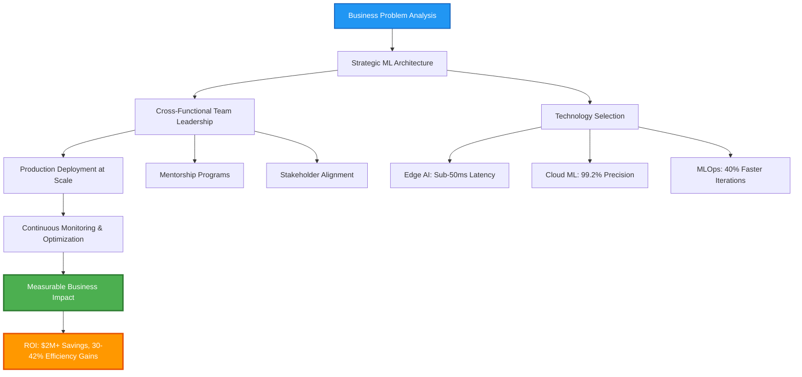
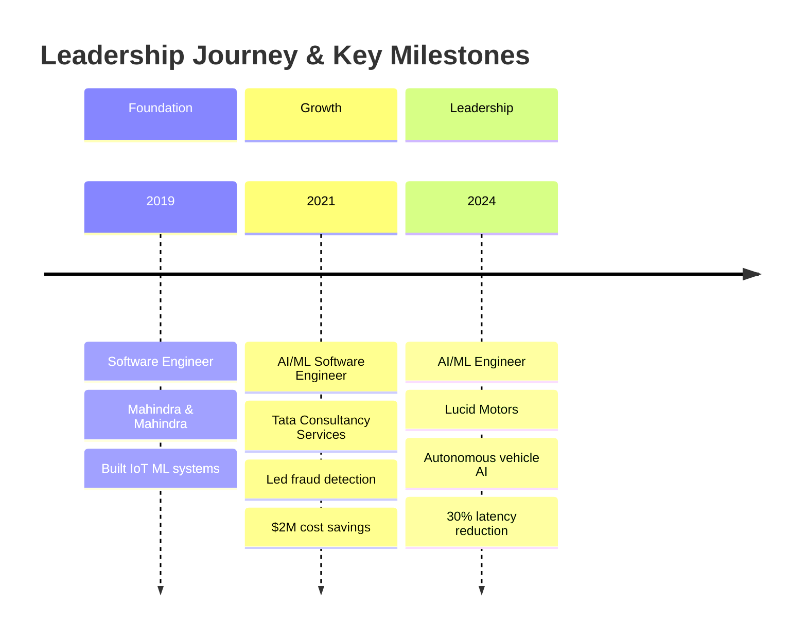
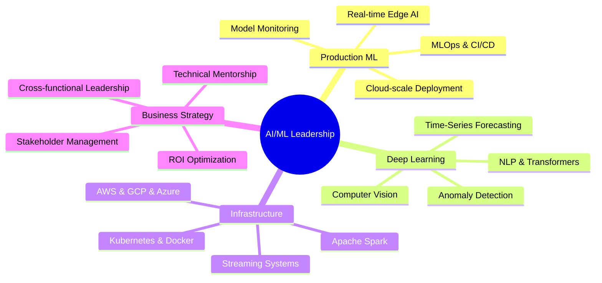

  

  
### 🎯 Transforming Business Vision into Intelligent Systems | 5+ Years Driving AI/ML Excellence

---

## 📊 EXECUTIVE PERFORMANCE DASHBOARD

| **METRIC** | **ACHIEVEMENT** | **BUSINESS IMPACT** |
|:---:|:---:|:---:|
| **🏢 Teams Led** | Cross-functional ML teams | 3 major organizations |
| **💰 Cost Optimization** | $2M+ annually | Infrastructure & downtime reduction |
| **🚀 Products Shipped** | 8+ production systems | Autonomous vehicles, IoT, fraud detection |
| **📈 Career Velocity** | 3 promotions in 5 years | Junior → ML Engineer → Senior AI/ML Engineer |
| **⚡ Performance Gains** | 30-42% improvements | Latency, accuracy, efficiency metrics |
| **🎯 Model Accuracy** | 94-99.2% precision | Real-time production systems |
| **👥 Mentorship** | Junior engineers coached | Accelerated team capability |

---

## 💼 EXECUTIVE SUMMARY

**Strategic AI/ML Engineering Leader** with proven track record of architecting and deploying mission-critical machine learning systems that drive measurable business outcomes. Demonstrated expertise in translating executive vision into scalable AI solutions across autonomous vehicles, financial services, and industrial IoT sectors.

**Core Leadership Competencies:**
- 🎯 **Strategic Architecture**: Designed end-to-end ML pipelines processing 2M+ daily transactions with 99.2% precision
- 💡 **Innovation Driver**: Pioneered real-time edge AI systems achieving sub-50ms latency on NVIDIA Orin platforms
- 📊 **Business Impact**: Delivered $2M+ annual savings through predictive maintenance and infrastructure optimization
- 🚀 **Technical Excellence**: Reduced deployment cycles from weeks to hours through MLOps automation
- 👥 **Team Leadership**: Mentored cross-functional teams, fostering collaboration between data science, engineering, and business stakeholders

---

## 🎓 LEADERSHIP PHILOSOPHY

> *"Great AI/ML systems are built at the intersection of technical excellence, business acumen, and human-centered design. My approach centers on understanding the strategic problem first, architecting scalable solutions that deliver measurable ROI, and building teams that can sustain innovation long after deployment."*

**Guiding Principles:**
- **Business-First Mindset**: Every model must solve a real business problem with quantifiable impact
- **Operational Excellence**: Production systems require monitoring, observability, and continuous improvement
- **Collaborative Innovation**: The best solutions emerge from diverse teams empowered to experiment
- **Sustainable Architecture**: Build for scale, maintainability, and adaptability to changing requirements

---

## 🗺️ STRATEGIC IMPACT FRAMEWORK

---

## 📈 CAREER PROGRESSION TIMELINE

---

## 🏆 KEY STRATEGIC ACHIEVEMENTS

### 🚗 **Autonomous Vehicle AI Leadership** | Lucid Motors (2024-Present)
**Role:** AI/ML Engineer | **Team Impact:** Cross-functional perception team

**Business Impact:**
- 🎯 **30% Latency Reduction**: Architected real-time object detection pipelines processing 120 FPS from vehicle cameras, enabling safer autonomous navigation
- ⚡ **35% Inference Optimization**: Deployed TensorRT-optimized models on NVIDIA Orin edge units achieving sub-50ms response times
- 📊 **200 Hours Saved**: Automated data labeling validation improving annotation accuracy from 88% to 96% across 500K+ frames
- 🔄 **40% Faster Experimentation**: Implemented A/B testing framework with MLflow enabling rapid model iteration without service disruption
- 🚀 **99.9% Uptime**: Deployed to 500+ production vehicles with zero rollback incidents through robust CI/CD pipelines

**Strategic Initiatives:**
- Led drift detection implementation preventing accuracy degradation through automated retraining triggers
- Pioneered synthetic data generation with GANs, boosting edge-case recall by 42%
- Built comprehensive Grafana monitoring reducing debugging turnaround by 50%

**Technologies:** PyTorch, TensorRT, OpenCV, Kubernetes, AWS SageMaker, MLflow, NVIDIA Orin

---

### 💳 **Financial Fraud Detection Architecture** | Tata Consultancy Services (2021-2023)
**Role:** AI/ML Software Engineer | **Business Value:** $2M+ annual savings

**Business Impact:**
- 💰 **$2M Cost Savings**: Developed fraud detection system processing 2M+ daily transactions with 99.2% precision, reducing false positives by 35%
- ⚡ **70% Efficiency Gain**: Automated feature engineering pipeline reducing manual effort and accelerating model iteration from weeks to 3 days
- 📈 **25% Inventory Optimization**: Built time-series forecasting models decreasing stockouts across 500+ retail locations
- 🚀 **20% Infrastructure Reduction**: Containerized legacy systems migrating to AWS ECS, cutting costs while improving reliability
- 📊 **12% Conversion Lift**: Designed A/B testing framework comparing champion vs challenger models on live traffic

**Strategic Initiatives:**
- Architected end-to-end ML workflows with Apache Airflow reducing deployment time from 3 weeks to 3 days
- Created interactive Streamlit dashboards enabling business stakeholders to query model predictions, boosting adoption by 40%
- Built RESTful API with FastAPI handling 10K+ concurrent requests at sub-200ms latency with 99.95% availability

**Technologies:** XGBoost, Apache Spark, Databricks, Airflow, Docker, AWS, PostgreSQL, FastAPI

---

### 🏭 **Industrial IoT Predictive Maintenance** | Mahindra & Mahindra (2019-2021)
**Role:** Software Engineer | **Business Impact:** $2M annual downtime savings

**Business Impact:**
- 💰 **$2M Savings**: Constructed predictive maintenance system for 10K+ machines detecting failures 48 hours in advance at 94% accuracy
- 📉 **30% Downtime Reduction**: Deployed real-time anomaly detection via MQTT and Kafka streams preventing unplanned outages
- 🎯 **25% False Alarm Reduction**: Engineered vibration and thermal features improving model ROC-AUC from 0.82 to 0.91
- 📊 **40% Faster Troubleshooting**: Integrated SHAP explanations into maintenance alerts enabling root cause analysis
- 🚀 **99.5% Uptime**: Containerized streaming applications on Kubernetes achieving enterprise-grade reliability

**Strategic Initiatives:**
- Tuned Spark Structured Streaming to handle 500K+ events/sec with exactly-once processing guarantees
- Established automated model retraining triggers maintaining freshness without manual intervention
- Designed Grafana dashboards visualizing machine health scores adopted by 50+ plant managers

**Technologies:** PySpark, Kafka, MQTT, InfluxDB, Kubernetes, XGBoost, SHAP, Grafana

---

## 💡 TECHNICAL EXPERTISE LANDSCAPE

---

## 🛠️ STRATEGIC TECHNOLOGY STACK

### **Machine Learning & AI Frameworks**

### **Production & MLOps Infrastructure**

### **Computer Vision & Edge AI**

### **Data Engineering & Databases**

---

## 🎯 FEATURED STRATEGIC PROJECTS

### 1. 🔐 **Enterprise-Grade MLOps Pipeline with DevSecOps**
**Strategic Value:** Production-ready CI/CD for ML models with security-first approach

**Business Impact:**
- Reduced model deployment time from days to under 2 hours
- Achieved zero rollback incidents through comprehensive testing
- Implemented security scanning catching vulnerabilities pre-production

**Architecture Highlights:**
- Jenkins-based CI pipeline with automated testing (JUnit, SonarQube)
- Trivy security scanning with S3 report archiving for compliance
- ArgoCD GitOps deployment to EKS with Prometheus/Grafana monitoring
- Integrated Slack notifications for real-time team awareness

**Technologies:** Jenkins, Docker, Kubernetes, ArgoCD, Prometheus, Grafana, Trivy, AWS

[🔗 View DevOps MasterPiece Project](https://github.com/arunvemula7-max/devops_masterpiece-ci-jenkins)

---

### 2. 🏥 **Microservices Observability Platform**
**Strategic Value:** Production monitoring for distributed ML systems

**Business Impact:**
- Enabled real-time performance tracking across microservices
- Reduced mean time to detection (MTTD) by 50%
- Improved system reliability through proactive alerting

**Architecture Highlights:**
- Jaeger distributed tracing for request flow visualization
- Prometheus metrics collection with custom business KPIs
- Grafana dashboards for executive-level insights
- Spring Boot & Apache Camel integration patterns

**Technologies:** Jaeger, Prometheus, Grafana, Spring Boot, Apache Camel, Kubernetes

[🔗 View Microservices Observability Project](https://github.com/arunvemula7-max/microservices-observability)

---

### 3. 💳 **Credit Card Fraud Detection with MLOps**
**Strategic Value:** Real-time fraud prevention with continuous model improvement

**Business Impact:**
- 99.2% precision in fraud detection
- Real-time prediction API serving 10K+ requests/sec
- Automated model retraining maintaining accuracy over time

**Architecture Highlights:**
- Multiple model comparison (Logistic Regression, Random Forest, XGBoost)
- LangChain integration for explainable AI predictions
- Docker container