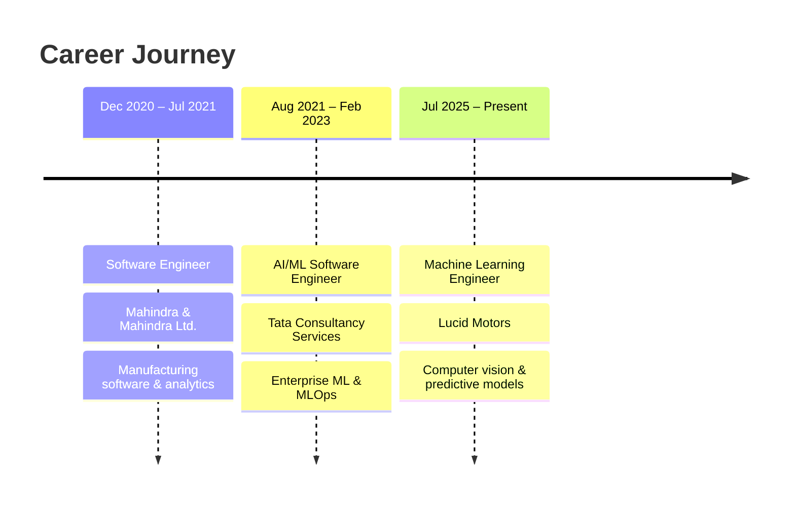
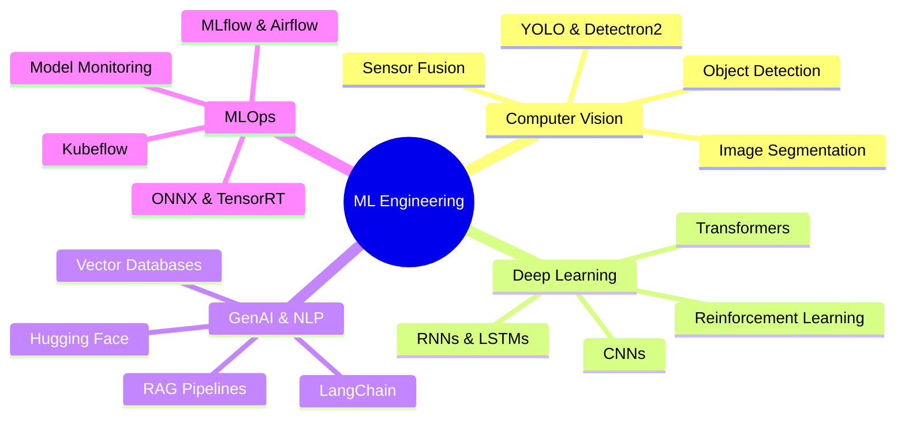

  

### 🎯 Machine Learning Engineer @ Lucid Motors | 3+ Years Building and Deploying AI/ML in Production

---

## 👋 About Me

I'm a **Machine Learning Engineer** with 3+ years of experience building and deploying AI/ML solutions across **automotive, enterprise consulting and manufacturing**.

- 🚗 **Now at Lucid Motors:** I build computer vision and predictive models for autonomous driving. My work improved detection accuracy by 25% and enabled sub-100ms inference on production vehicle platforms.
- 🏢 **Before that, at TCS:** I delivered end-to-end ML for enterprise clients (predictive maintenance, demand forecasting, NLP automation). MLOps pipelines I built cut model deployment time by 40%.
- 🏭 **Started at Mahindra & Mahindra:** I built software and analytics tools for automotive manufacturing that cut manual effort by 35% and gave plant teams better production visibility.
- 🧠 **I work with:** CNNs, LSTMs, Transformers, RAG pipelines and LLM integration, using Python, PyTorch, TensorFlow, scikit-learn, SQL, AWS, Docker, Kubernetes, MLflow and Airflow.

---

## 📊 Impact at a Glance

| **Area** | **Result** | **Where** |
|:---:|:---:|:---:|
| 👁️ **Object detection accuracy** | +25% | Lucid Motors, autonomous driving datasets |
| ⚡ **Inference latency** | Sub-100ms | Lucid Motors, onboard & edge deployments |
| 🔋 **Battery / range prediction error** | −20% | Lucid Motors, LSTM + XGBoost models |
| 🚀 **AI features in production** | 10+ | Lucid Motors vehicle platforms |
| 📦 **Production models delivered** | 8+ | TCS, enterprise clients |
| ⏱️ **Model deployment time** | −40% | TCS, MLflow + Airflow + Docker pipelines |
| 🏭 **Unplanned downtime** | −25% | TCS, predictive maintenance on IoT data |
| 🛠️ **Manual effort in plant reporting** | −35% | Mahindra & Mahindra, Python/SQL automation |

---

## 📈 Career Timeline

---

## 💼 Experience

### 🚗 **Machine Learning Engineer** | Lucid Motors, Newark, CA (Jul 2025 – Present)

- 👁️ Built computer vision models (CNNs, YOLO) for object detection, lane tracking and environment perception, improving detection accuracy by **25%** on autonomous driving datasets
- 🔋 Built predictive models for battery health, range estimation and failure prediction with LSTM and XGBoost, reducing prediction error by **20%**
- ⚡ Designed and deployed real-time inference services with FastAPI, Docker and Kubernetes, giving **sub-100ms** responses for onboard and edge deployments
- 🔄 Built Spark, Kafka and Airflow pipelines for sensor, telemetry and vision data, improving training-data availability by **40%**
- 📋 Integrated MLflow and model-registry workflows for experiment tracking, model versioning and automated retraining, cutting manual MLOps effort by **35%**
- 📉 Set up drift and performance monitoring with proactive alerting, reducing production incidents by **30%**
- 🤝 Worked with vehicle engineering, software and data teams to deliver **10+ AI features** into production vehicle platforms

**Stack:** Python, PyTorch, TensorFlow, OpenCV, YOLO, FastAPI, Docker, Kubernetes, Apache Spark, Kafka, Airflow, MLflow, AWS (S3, EC2, SageMaker), PostgreSQL

---

### 🏢 **AI/ML Software Engineer** | Tata Consultancy Services, India (Aug 2021 – Feb 2023)

- 📦 Built end-to-end ML solutions for enterprise clients in manufacturing, retail and financial services, delivering **8+ production models**
- 🏭 Built predictive-maintenance models (LSTM, time-series analysis) on IoT sensor data, reducing unplanned downtime by **25%**
- 📈 Built demand-forecasting and anomaly-detection models with XGBoost and scikit-learn, improving forecast accuracy by **20%**
- 📄 Built NLP automation for document classification and information extraction with spaCy and Hugging Face Transformers, reducing manual processing by **40%**
- 🚀 Designed and deployed MLOps pipelines with MLflow, Airflow and Docker, cutting model deployment time by **40%** and automating retraining
- 🗄️ Built Spark and SQL pipelines over large structured and unstructured datasets, reducing processing time by **30%**

**Stack:** Python, TensorFlow, PyTorch, scikit-learn, spaCy, Hugging Face, Apache Spark, SQL, MLflow, Airflow, Docker, AWS, Azure

---

### 🏭 **Software Engineer** | Mahindra & Mahindra Ltd., India (Dec 2020 – Jul 2021)

- 🛠️ Built Python and SQL automation for production data collection, validation and reporting, reducing manual effort by **35%** across manufacturing lines
- 📊 Built Power BI and Tableau dashboards for production KPIs, quality metrics and downtime, giving plant operations teams better visibility
- 🔗 Built SQL data models and ETL workflows that consolidated manufacturing-system data, improving reporting accuracy by **25%**
- ⏱️ Automated recurring reports and data-validation checks, saving **15+ hours** of manual work every week
- ✅ Followed SDLC practices and code reviews, reducing production defects by **20%**

**Stack:** Python, SQL, Power BI, Tableau, ETL

---

## 🎯 Key Projects

### 1. 🚗 **Autonomous Driving Perception Models** | Lucid Motors, 2025
- Built CNN and YOLO computer vision models for object detection and lane tracking, improving detection accuracy by **25%** on autonomous driving datasets
- Deployed real-time inference services on edge and cloud with FastAPI, Docker and Kubernetes, with **sub-100ms** responses

### 2. 🏭 **Predictive Maintenance for Manufacturing** | TCS, 2022
- Built LSTM and time-series models on IoT sensor data to predict equipment failures, reducing unplanned downtime by **25%** for client manufacturing operations
- Added MLflow-based monitoring and automated retraining, cutting model deployment time by **40%**

### 3. 📄 **NLP Document Automation** | TCS, 2022
- Built document classification and information-extraction pipelines with spaCy and Hugging Face Transformers, reducing manual processing by **40%**
- Connected the models to enterprise workflows through REST APIs to route documents automatically

---

## 💡 Technical Expertise

---

## 🛠️ Technology Stack

### **Languages**

### **Machine Learning & Deep Learning**

### **Computer Vision**

### **Generative AI & NLP**

### **MLOps & Deployment**

### **Cloud**

### **Data Engineering & Databases**

### **Backend, BI & DevOps**

---

## 🏅 Certifications

- 🧠 **TensorFlow Developer Certificate**
- ☁️ **AWS Certified Machine Learning**

---

## 🎓 Education

- **Master of Science in Information Technology Management**, Indiana Wesleyan University, Indiana
- **Bachelor of Engineering in Computer Science**, Osmania University, Hyderabad, India

---

## 🤝 Let's Connect

I'm interested in **machine learning engineering roles** in computer vision, predictive modeling and production MLOps.

  

